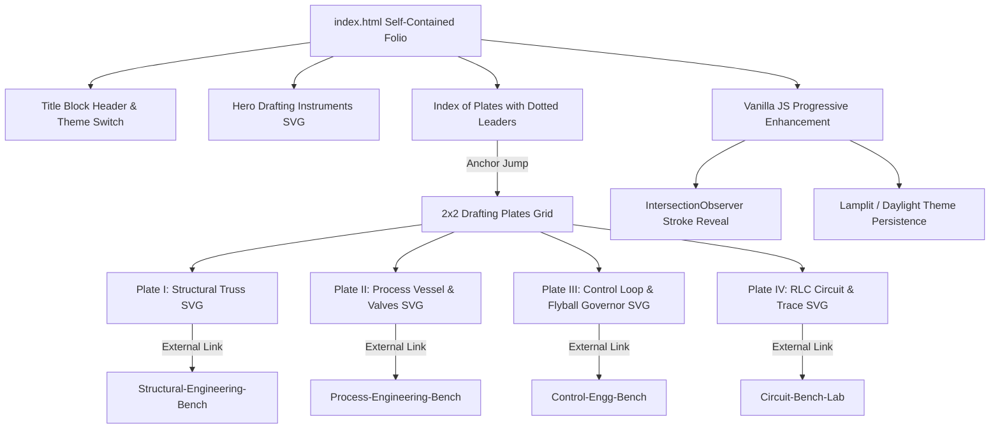

# Engineering Benches


An antique engineer's drawing folio category landing page introducing four browser-based engineering workbenches. Built as a single self-contained HTML file with inline CSS, inline SVG technical drawings, and lightweight vanilla JavaScript.

## Included Workbenches

| Plate | Tool | Description | Live Bench |
| :--- | :--- | :--- | :--- |
| **Plate I** | Structural Engineering Bench | Structural engineering analysis workbench. | [Open Bench](https://nirmalya-panigrahi.github.io/Structural-Engineering-Bench/) |
| **Plate II** | Process Engineering Bench | Process engineering calculation workbench. | [Open Bench](https://nirmalya-panigrahi.github.io/Process-Engineering-Bench/) |
| **Plate III** | Control Engg Bench | Control systems engineering workbench. | [Open Bench](https://nirmalya-panigrahi.github.io/Control-Engg-Bench/) |
| **Plate IV** | Circuit Bench Lab | Electronic and electrical circuit lab. | [Open Bench](https://nirmalya-panigrahi.github.io/Circuit-Bench-Lab/) |

## Architecture



## Local Setup & Verification

```bash
# Install dev/build dependencies
npm install --legacy-peer-deps

# Start local dev server on port 3000
npm run dev

# Run automated unit & DOM integration tests
npm test

# Build static production output into dist/
npm run build
```

## Deployment

Pushing to `main` triggers `.github/workflows/deploy.yml`, which runs `npm test` and `npm run build` on Node.js 22 and publishes `dist/` to GitHub Pages.
